<!-- Arquivo gerado pelo readme-kit. Não edite aqui: altere docs/readme/ e rode "readme-kit build". -->
<div align="center">


<br />

<a href="https://vexoradn.vercel.app"></a>
<a href="https://github.com/diegonatalo/vexora"></a>

<br />


</div>

<br />

<div align="center">

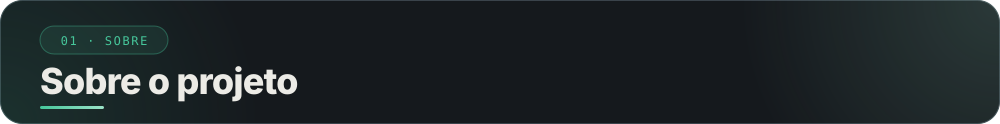

</div>

**Cadastre seu perfil uma vez e baixe um CV de 1 página otimizado para ATS.**<br />
O Vexora é um gerador de currículo em PDF. Você cadastra seu perfil uma vez, confere a verificação ATS (os sistemas que leem currículos antes de um recrutador) e baixa um CV de 1 página que esses sistemas conseguem ler.

Tudo roda no navegador: não há backend, login nem IA generativa. Seus dados ficam só no seu navegador (IndexedDB) e podem ser exportados e importados em JSON para backup. A interface é em português do Brasil.

<br />

<div align="center">

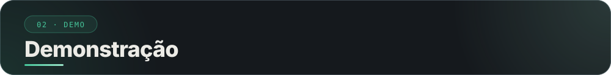

</div>

<div align="center">

<picture><source media="(prefers-color-scheme: dark)" srcset="docs/assets/shot-01.svg" />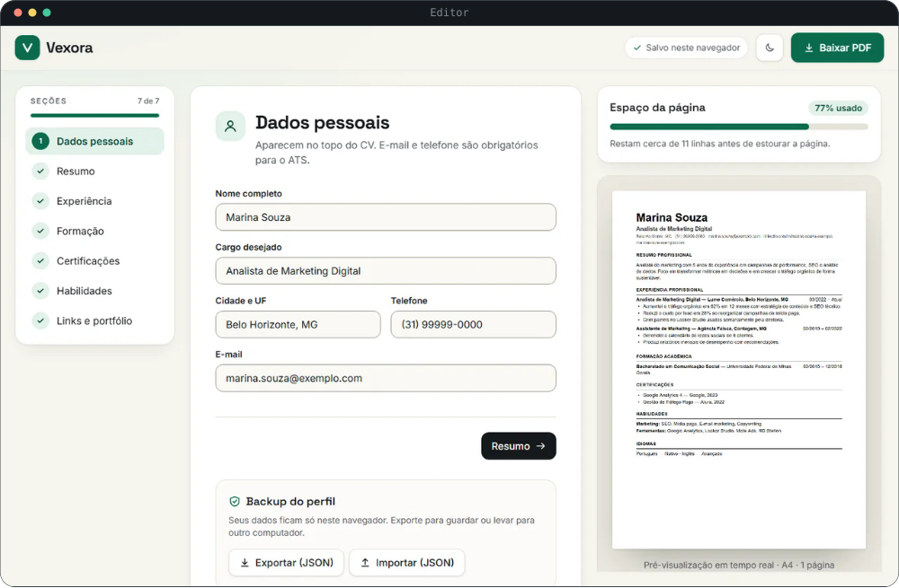</picture>
<br />
<sub><b>Editor</b>: seções à esquerda, formulário no centro e pré-visualização do PDF à direita. Os dados do print são fictícios.</sub>

<br />

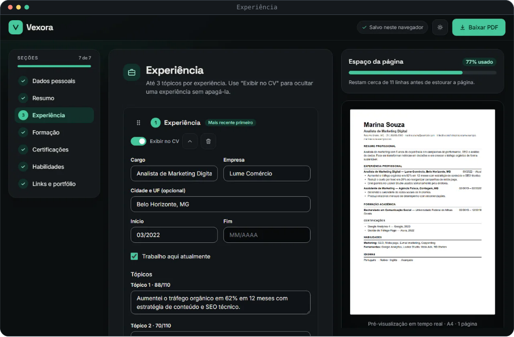
<br />
<sub><b>Experiência</b>: "Exibir no CV" oculta o item do PDF sem apagá-lo.</sub>

<br />

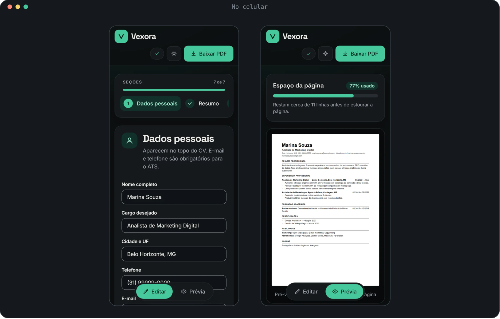
<br />
<sub><b>No celular</b>: o seletor Editar e Prévia alterna entre o formulário e o PDF.</sub>

</div>

<br />

<div align="center">

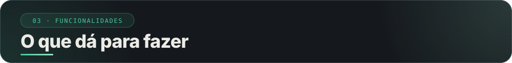

</div>

<div align="center">

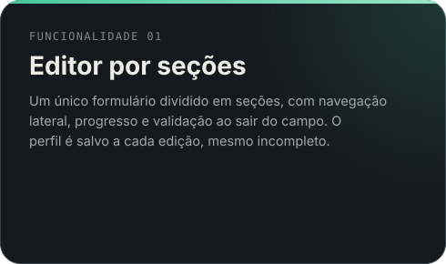
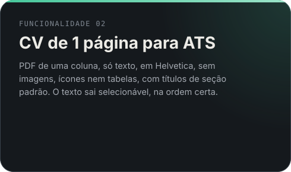
<br />
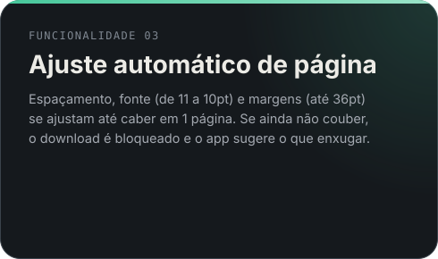
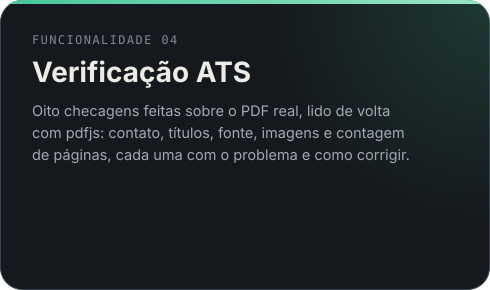
<br />
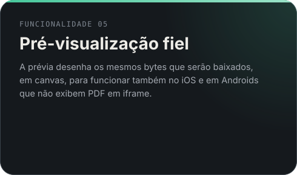
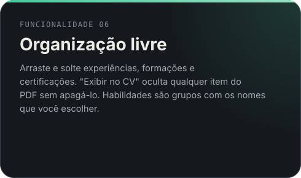
<br />
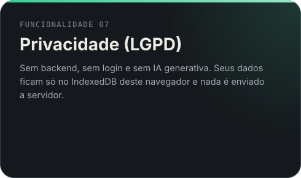
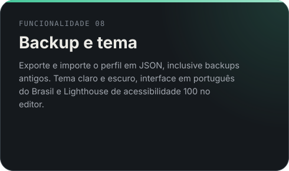

</div>

<br />

<div align="center">

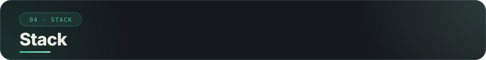

</div>

<div align="center">

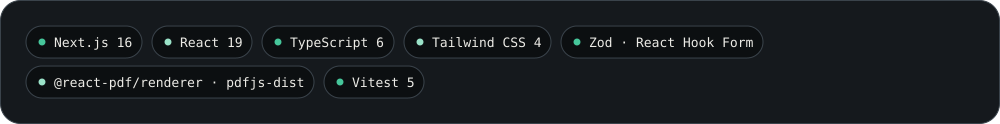

</div>

<br />

<div align="center">

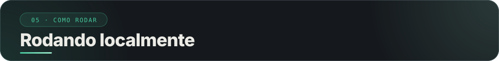

</div>

Requer [Node.js](https://nodejs.org) 22 ou superior.

```bash
git clone https://github.com/diegonatalo/vexora.git
cd vexora
pnpm install
pnpm dev        # http://localhost:3000
```

| Comando | O que faz |
|---|---|
| `pnpm dev` | Servidor de desenvolvimento |
| `pnpm build` | Gera o build de produção |
| `pnpm start` | Serve o build de produção |
| `pnpm lint` | Roda o ESLint |
| `pnpm typecheck` | Confere os tipos do TypeScript |
| `pnpm test` | Roda os testes uma vez |
| `pnpm test:watch` | Roda os testes e reexecuta ao salvar |
| `pnpm check` | Roda typecheck, lint e testes em sequência |

### 🔑 Variáveis de ambiente

Nenhuma é obrigatória. `NEXT_PUBLIC_SITE_URL` é opcional: define o endereço público usado no sitemap, no robots e nas imagens de compartilhamento.

<br />

<div align="center">

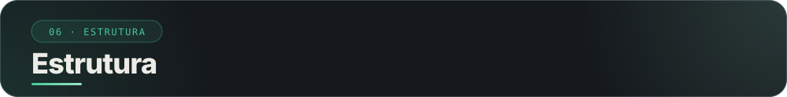

</div>

```text
docs/             decisões de projeto (decisions.md) e fontes deste README
public/           arquivos estáticos
├── app/          rota /editor, layout, metadados, sitemap e robots
├── components/   editor (seções, ATS, backup), preview, ui e pdf (documento do CV, react-pdf)
├── lib/          schema, storage, ajuste de página, checagens ATS e geração do PDF
└── tests/        utilitários de teste de PDF
```

<br />

<div align="center">

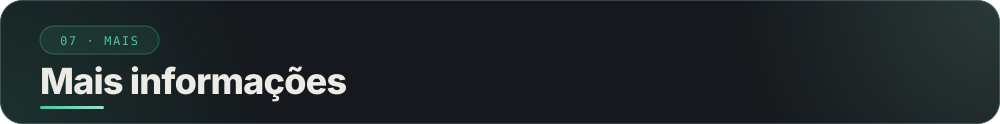

</div>

### 🧠 Como funciona

| Conceito | Regra |
|---|---|
| **PDF real** | O PDF é gerado como texto com `@react-pdf/renderer` e lido de volta com `pdfjs-dist`. As checagens e a contagem de páginas usam o arquivo real, não uma estimativa. |
| **Ajuste para 1 página** | Seis níveis, do padrão (11pt) até margens de 36pt, passando por espaçamento menor e fonte de 10,5 e 10pt. Se nem o último couber, o download fica desabilitado. |
| **Exibir no CV** | Cada experiência, formação, certificação, idioma e grupo de habilidades pode ser ocultado do PDF sem apagar. Não há limite de itens. |
| **Rascunho sempre salvo** | O formulário aceita campos vazios. O que estiver preenchido precisa ser válido, e a obrigatoriedade de e-mail e telefone é cobrada pela verificação ATS. |
| **Bloqueio do download** | Só nome vazio e CV acima de 1 página bloqueiam o botão. As demais falhas aparecem como avisos. |

Todas as decisões, com o porquê, estão em [`docs/decisions.md`](docs/decisions.md).

### 🔎 SEO e compartilhamento

- `sitemap.xml` e `robots.txt` vêm de `app/sitemap.ts` e `app/robots.ts`.
- Open Graph e Twitter Card (título, descrição e imagem de 1200x630) são definidos em `app/layout.tsx`. A rota `/editor` tem título próprio.
- O endereço público vem de `lib/site.ts`: `NEXT_PUBLIC_SITE_URL` se definida, `http://localhost:3000` em desenvolvimento e `https://vexoradn.vercel.app` nos demais casos.
- Favicon: `icon.svg`, `favicon.ico` e `apple-icon.png` em `app/`.

### 🌐 Deploy

O site é publicado na Vercel em <https://vexoradn.vercel.app>. Basta importar o repositório e usar as configurações padrão do Next.js. Não há variáveis obrigatórias.

Ao trocar para um domínio próprio, defina `NEXT_PUBLIC_SITE_URL` (por exemplo `https://vexora.app`) para que o sitemap e as imagens de compartilhamento apontem para ele.

### 📄 Créditos e licença

- Distribuído sob a licença **MIT**. Veja o arquivo [LICENSE](LICENSE).

<br />

<div align="center">

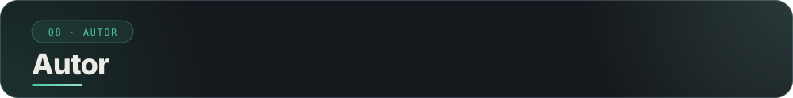

</div>

<div align="center">

<a href="https://diegonatalo.dev"></a>
<a href="https://www.linkedin.com/in/diegonatalo/"></a>
<a href="https://github.com/diegonatalo"></a>

</div>

<br />

<div align="center">

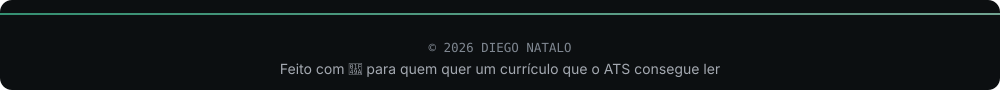

</div>
